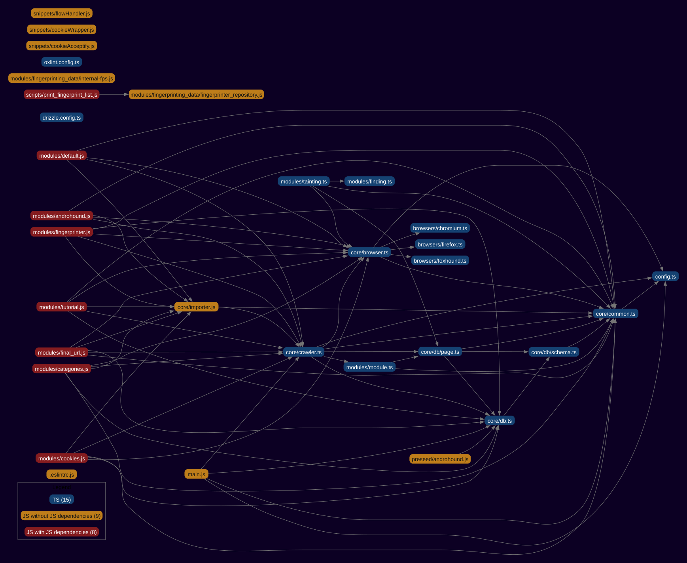

# Typescript migration map

When migrating projects from JavaScript to TypeScript, you need to start on those files that depend on no files written in JS.
This project generates an overview of all the `import`-dependencies of a JavaScript (or mixed JS/TS) project.
The colors of the file-nodes suggest the readyness-state for the migration.

- <span style="color:blue">Blue</span>: The file is already a TypeScript file, nothing to do.
- <span style="color:orange">Orange</span>: The file is JS and ready to be migrated. It does not depend on any files written in JS.
- <span style="color:red">Red</span>: The file is JS and cannot be migrated yet, it depends on JS.

This project is powered by [Madge](https://github.com/pahen/madge).

## Installation

```
npm ci
```

## Usage

```
node index.js <path-to-project-root>
```

## Example Output:

